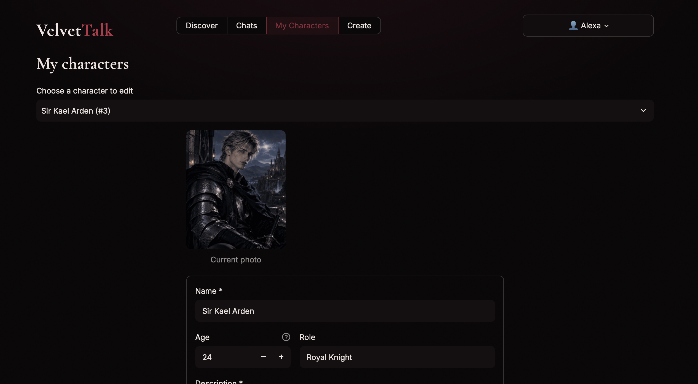
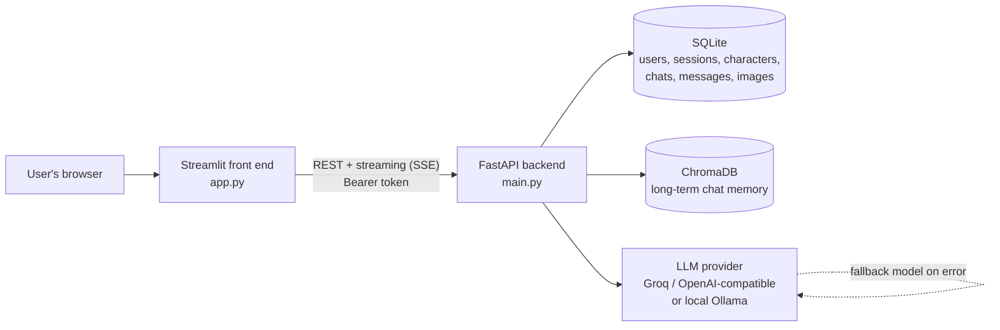

# VelvetTalk

Chat with AI characters that remember you. Users sign up, pick or create a character, and talk in real time while the app keeps the story consistent using a prompt pipeline and vector memory.

**Built with:** FastAPI · Streamlit · SQLite · ChromaDB · Groq/OpenAI-compatible LLM APIs · Deployed on Render

## Demo

| Discover | Chat |
|---|---|
|  |  |

| Create | My Characters |
|---|---|
|  |  |

## Features

**Chat**
- Real-time streaming replies, with a one-click **Regenerate** for the last reply
- Multiple chats per user, with a chat list and per-chat delete
- **Long-term memory:** every exchange is embedded in ChromaDB. Once a chat grows past the recent-history window, relevant older exchanges are recalled by semantic search and added to the prompt, so a character can remember something said many messages earlier
- Recent-history window (configurable) plus a distance threshold, so only relevant memories reach the prompt

**Characters**
- Built-in characters, plus user-created characters that can be edited, deleted and given a photo
- **Auto-fill:** give a name and short description, and the LLM generates personality, scenario, example dialogue and first message, without overwriting anything the user wrote
- Automatic character-gender detection, with a pronoun-consistency check that retries if the output uses the wrong pronouns
- Character cards with age, role, tagline, tags and photo

**Prompt pipeline**
- Structured system prompt with rules for formatting, pacing, continuity and reply length
- Gender-aware placeholders so one character card works for any user
- Replies are trimmed to the last complete sentence if the token limit cuts them off
- If the model call fails, the user's message is rolled back, so retrying never creates a duplicate

**Safety**
- Adults-only: age validation plus pattern checks for under-18 details in any field
- Real-person block: a name list plus an LLM check, so characters can't impersonate public figures

**Accounts and security**
- Sign up with email, username and password; one account per email; log in with email and password
- Passwords hashed with PBKDF2-SHA256 (240,000 rounds, per-user salt)
- Session tokens stored only as SHA-256 hashes, expiring after 14 days
- Lockout after 5 failed logins, and a per-IP signup rate limit
- Ownership checks on every chat, so users can't open each other's chats

**LLM layer**
- Works with any OpenAI-compatible API (Groq, OpenRouter) or local Ollama, chosen by environment variables
- Automatic fallback to a second model on rate limits, outages or empty replies

**UI**
- Custom-styled Streamlit front end: card grid, chat list, loading states and page transitions
- Parallel API calls and a short cache, to keep screens fast on a free-tier server

## Architecture



### What happens when you send a message

1. The browser sends the message to Streamlit, which calls `POST /chats/{id}/messages` on the backend with the user's session token.
2. The backend checks the token against the `sessions` table (stored as a SHA-256 hash) and checks that the chat belongs to that user. The user's message is saved to SQLite before the model is called.
3. It loads the last N messages from SQLite and asks ChromaDB for the most relevant older exchanges from the same chat.
4. It builds the prompt: the character card, user-gender wording, the writing rules, the recalled memories, the recent history and a short reminder attached to the last user message.
5. The prompt goes to the LLM. If the main model fails, the fallback model is tried.
6. The reply streams back to Streamlit token by token. It is then saved to SQLite and embedded into ChromaDB for later recall.

### Where data lives

| Store | What it holds |
|---|---|
| SQLite (`app.db`) | Accounts, sessions, characters, chats, messages, character photos |
| ChromaDB (`chroma_data/`) | Embeddings of past exchanges for long-term memory, filtered per chat |
| Environment variables | LLM endpoint, API key, model names |
## Tech stack

| Layer | Technology |
|---|---|
| Backend API | FastAPI, Uvicorn, Pydantic |
| Front end | Streamlit with custom CSS, Pillow for photo processing |
| Database | SQLite (accounts, sessions, characters, chats, messages, photos) |
| Vector memory | ChromaDB |
| LLM | Any OpenAI-compatible API (Groq, OpenRouter) through the `openai` client, or local Ollama |
| Auth | PBKDF2-SHA256 password hashing, hashed session tokens, cookie-based session restore |
| Hosting | Backend (FastAPI) on Render; the Streamlit front end runs locally and connects to the hosted API |

## How it works

### Prompt design
Every chat starts from one structured system prompt built from the character card (description, personality, scenario, example dialogue) plus a fixed set of writing rules: formatting, reply length, continuity, setting, and how fast the story moves. Small details matter here:
- **Reminder on the last message.** Small models follow the most recent instruction best, so a short reminder of the key rules is attached to the last user message on every request. It is never saved to the database.
- **No lost context.** Ollama defaults to a 2,048-token window, which silently cut off the system prompt. The context size is set explicitly to 8,192.
- **Gender-aware cards.** Character cards use placeholders such as `{{user}}`, `{{char}}` and pronoun tokens, so one card works for any user.

### Pacing that follows the user
Characters can define stages (for example reserved, then warming up, then close). The rules tell the model to move through them at the speed the user's tone sets, never to assume closeness the story hasn't built, and to slow down if the user pulls back. The built-in demo character, Nora Vale, shows the pattern.

### Memory
Recent messages go into the prompt directly. Older exchanges are embedded in ChromaDB and recalled by semantic search, but only those that fall outside the recent window, so the same text never appears twice. Recalled memories are added as "earlier in this chat" notes, with an instruction to treat them as true and not invent details.

### Character auto-fill
When a user creates a character with only a name and a short description, the LLM writes the missing sections once, at creation time rather than during chat. The output is validated before it is saved:
- the example dialogue must match the expected format, or it is dropped
- the first message must contain both narration and speech
- if the wrong pronouns appear, it retries once, then falls back to safe defaults
- anything the user wrote is never overwritten

### Safety checks
Characters are checked at creation and on every edit. Under-18 details are blocked by age validation and pattern matching across all fields. Real public figures are blocked by a name list plus an LLM check.

### Reliability
The LLM client tries a fallback model if the main one fails or returns nothing. If both fail, the user's message is removed from the database, so a retry doesn't create duplicates, and the user sees a short "model is busy" message.

## Run it locally

**Requirements:** Python 3.14 (the version this was developed and tested on), and either an API key for an OpenAI-compatible provider (such as Groq) or [Ollama](https://ollama.com) installed locally.

```bash
git clone https://github.com/ritikakatta24-beep/Ai_chat_app.git
cd Ai_chat_app
python3 -m venv venv
source venv/bin/activate
pip install -r requirements.txt
pip install -r requirements-frontend.txt
```

### 1. Start the backend

**Option A: hosted model (Groq or any OpenAI-compatible API)**
```bash
export LLM_BASE_URL="https://api.groq.com/openai/v1"
export LLM_API_KEY="your_api_key"
export LLM_MODEL="your_main_model"
export LLM_FALLBACK_MODEL="your_backup_model"   # optional
uvicorn main:app --reload --port 8000
```

**Option B: local model with Ollama**
```bash
ollama pull qwen2.5:7b
uvicorn main:app --reload --port 8000
```
Ollama is used automatically when `LLM_BASE_URL` is not set. Use `CHAT_MODEL` to pick a different Ollama model.

### 2. Start the front end

In a second terminal:
```bash
source venv/bin/activate
API_URL=http://localhost:8000 streamlit run app.py
```
Open http://localhost:8501, create an account and start chatting. Without `API_URL`, the front end connects to the author's hosted demo backend.

### Configuration

| Variable | Purpose | Default |
|---|---|---|
| `LLM_BASE_URL`, `LLM_API_KEY`, `LLM_MODEL` | Hosted OpenAI-compatible model | not set (uses Ollama) |
| `LLM_FALLBACK_MODEL` | Second model tried if the first fails | not set |
| `CHAT_MODEL` | Ollama model name | `qwen2.5:7b` |
| `CONTEXT_MESSAGES` | Recent messages sent to the model | `20` (10 suggested on free tiers) |
| `REASONING_EFFORT` | For gpt-oss models: low, medium or high | `low` |
| `API_URL` | Backend address used by the front end | hosted demo URL |

The SQLite database (`app.db`) and the ChromaDB folder (`chroma_data/`) are created automatically on first run. The first chat may be slow while ChromaDB downloads its embedding model.