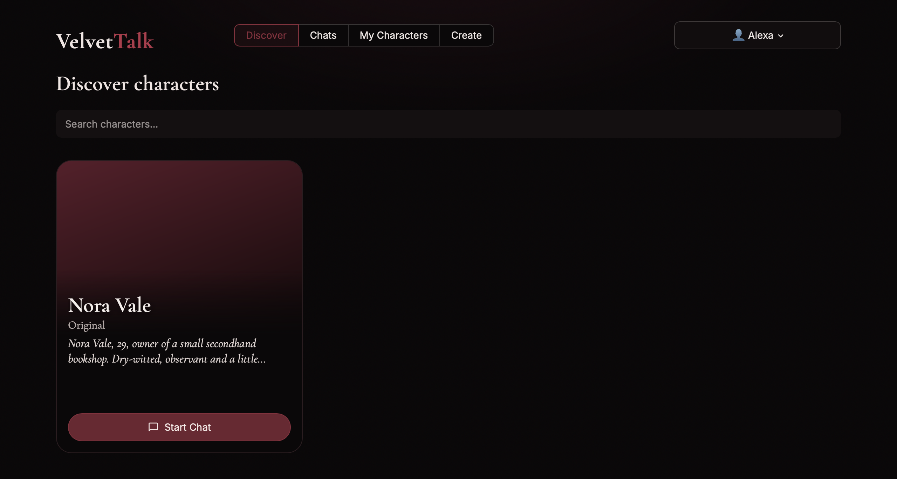
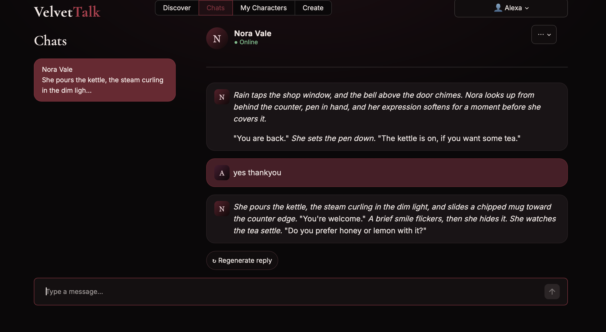
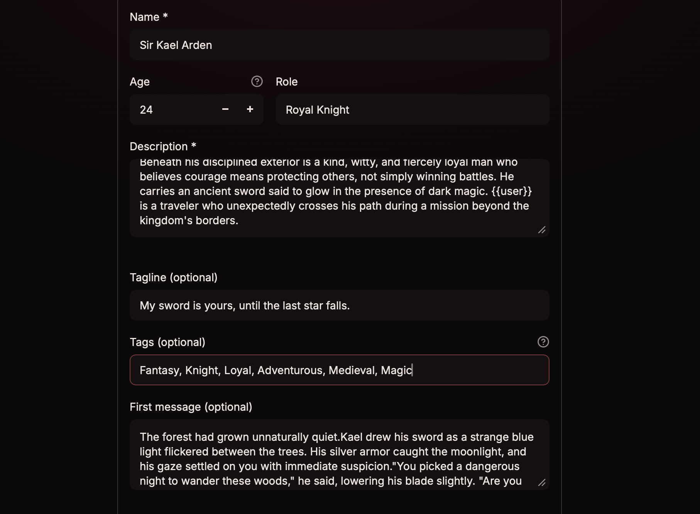

# VelvetTalk

Chat with AI characters that remember you. Users sign up, pick or create a character, and talk in real time while the app keeps the story consistent using a prompt pipeline and vector memory.

**Built with:** FastAPI · Streamlit · SQLite · ChromaDB · Groq/OpenAI-compatible LLM APIs · Deployed on Render

## Demo

*60-second walkthrough: signup, chatting with a character, memory recall, and creating a new character.*

| Discover | Chat | Create |
|---|---|---|
|  |  |  |
